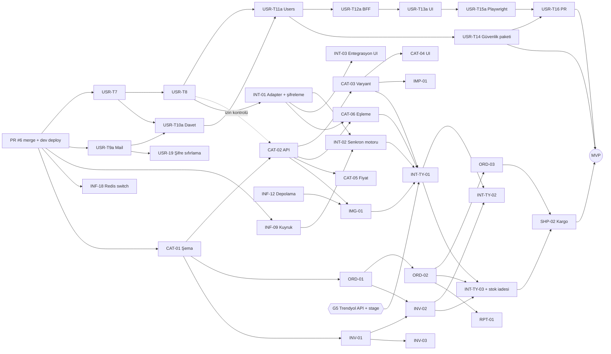

# Bağımlılıklar ve Kritik Yol

Görev ayrıntıları: `TASK_REGISTER.md`. Bu dosya yalnızca sıralamayı gösterir.

## 1. Kapılar (görev olmayan önkoşullar)

| Kapı | Neyi açar | Kim |
|---|---|---|
| G1 PR #6 merge (M0, dev deploy dahil) | USR-T7, USR-T9a, CAT-01, INF-09, INF-18 (A); INF-19, SUB-01 (B) | Kullanıcının sohbette açık onayı |
| G2 Task 7 başlatma onayı | USR-T7 | Kullanıcı ("Task 7'ye başlama" talimatı geçerli) |
| G3 Her yeni migration'ın dev DB'ye uygulanması | CAT-01, ORD-01, INV-01, INT-01, ... | Kullanıcı onayı + prova çıktısı |
| G4 Aşama 2 migration onayı | USR-18 | Kullanıcı |
| G5 Dış erişim — **MVP'nin ana dış kapısı: Trendyol API + stage erişimi** (IP whitelist, stage ortamı doğrulanmadı) | INT-TY-01…03, SHP-02 (A); diğer INT-* (sandbox/anahtar), EFT-01 (entegratör), SUB-02 (ödeme), INF-11 (barındırma) | Kullanıcı |

## 2. MVP kritik yolu (Trendyol-only, paralel akışlarla)

En uzun bağımlılık zinciri (iş günü):

```
G1 PR #6 merge + dev deploy (M0)
 → USR-T7 Rol kataloğu (2)
 → USR-T8 Firma başına rol (2)
 → INT-01 Adapter + kimlik bilgisi şifreleme (4)
 → INT-02 Senkron motoru (5)              [INF-09 de gerekir]
 → INT-TY-01 Trendyol listeleme (5)        [CAT-06, CAT-03, IMG-01 de gerekir; G5 Trendyol stage erişimi]
 → INT-TY-03 Trendyol sipariş, iptal/iade + stok iadesi (6)   [ORD-02, INV-02 de gerekir]
 → SHP-02 Kargo etiketi/takip (3)
 → MVP kabul (5)
```

Toplam ≈ 27 iş günü sıralı iş (+5 kabul). Paralel kısaltmalar (kullanıcı kararı):

- **CAT-01 → CAT-02, USR-T7 → USR-T8 ile paralel** (akış 1 / akış 2). CAT-01 yalnızca G1'i bekler; CAT-02'nin firma izin kontrolü merge öncesi USR-T8'e bağlanır.
- **CAT-03, CAT-06 ile paralel.** CAT-06 artık CAT-02 + INT-01'i bekler; varyant özellik eşlemesi INT-TY-01'de birleşir.
- Katalog zinciri G1 → CAT-01 (3) → CAT-02 (3) → CAT-06 (4) = 10 gün; INT-01 G1'den 8. günde biter, bu yüzden CAT-06 ≈ 12. günde, INT-02 ≈ 13. günde biter ve INT-TY-01'i ≈ 13. günde açar.

Takvim süresini kritik yol değil kapasite belirler: 110,5 iş günü / 2 akış ≈ 55 gün > 27 gün. Kritik yoldaki asıl risk **G5 Trendyol stage erişimi**dir: INT-TY-01 başlangıcına (≈ 2026-12-28) kadar gelmezse INT-TY-01…03 ve SHP-02 `BLOCKED` olur.

Kullanıcı yönetimi zinciri (USR-T9a → T10a → T11a → T12a → T13a → T15a → T16 ≈ 11,5 gün) akış 2'de; USR-T11a USR-T8'i de bekler.

## 3. Grafik (MVP)



## 4. Sürüm B ve C önemli bağımlılıklar

- **e-Fatura:** INT-01 + ORD-02 → EFT-01 (entegratör sözleşmesi, G5) → EFT-02 → EFT-03 / EFT-04. SUB-03 abonelik faturası EFT-02'yi bekler.
- **Ödeme:** SUB-01 → SUB-02 (ödeme sağlayıcı hesabı, G5) → SUB-03; SUB-01 → SUB-04; SUB-01 + USR-T11 → OPS-04.
- **MVP'den ertelenenler (B):** INT-02 + CAT-06 → INT-HB-01 → INT-HB-02/03; ORD-02 + INV-02 → SHP-01; INT-02 → INT-04; IMP-01 + INF-09 → IMP-02; IMG-01 + INF-09 → IMG-02; ORD-01 → CRM-01 → CRM-02; INV-02 → RPT-02; ORD-02 + INV-01 + INT-03 → DSH-02; USR-T9a…T15a → USR-T9…T15 kalan kısımları (`T9b`…`T15b`).
- **Kârlılık ve hakediş:** CAT-05 + ORD-01 → PRF-01 → PRF-02 (SHP-01 de) → PRF-03; INT-TY-03 + INT-HB-03 → STL-01 → STL-02 (PRF-01 de) → STL-03.
- **Prod:** INF-10 → INF-11 → INF-13, INF-14, INF-17, OPS-02, OPS-06 → OPS-07 (B'nin son görevi).
- **Aşama 2:** USR-T16 + G4 → USR-18. Guard ve login/refresh'in `users.is_active` okuması (`backend/src/auth/user-state.ts`, `auth.repository.ts`) kaldırılmadan migration çalıştırılamaz.
- **AI:** INF-09 → AIE-01 → AIU-01..03, AIE-02..04, IMG-03, CMP-03. `ai-engine` diğer modüllerin tablolarına bağımlı değildir; yalnızca servis arayüzlerine/istek verisine bağımlıdır.
- **Diğer pazaryerleri:** her biri yalnızca INT-02 + CAT-06 (+ INV-02, ORD-02) bekler; birbirinden bağımsızdır ve dış erişim geldiği sırayla yapılabilir.
