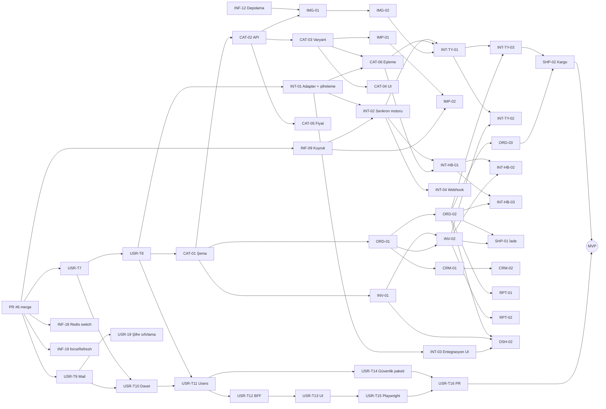

# Bağımlılıklar ve Kritik Yol

Görev ayrıntıları: `TASK_REGISTER.md`. Bu dosya yalnızca sıralamayı gösterir.

## 1. Kapılar (görev olmayan önkoşullar)

| Kapı | Neyi açar | Kim |
|---|---|---|
| G1 PR #6 merge | USR-T7, USR-T9, INF-09, INF-18, INF-19, SUB-01 | Kullanıcının sohbette açık onayı |
| G2 Task 7 başlatma onayı | USR-T7 | Kullanıcı ("Task 7'ye başlama" talimatı geçerli) |
| G3 Her yeni migration'ın dev DB'ye uygulanması | CAT-01, ORD-01, INV-01, INT-01, ... | Kullanıcı onayı + prova çıktısı |
| G4 Aşama 2 migration onayı | USR-18 | Kullanıcı |
| G5 Dış erişim | INT-* (sandbox/anahtar), EFT-01 (entegratör), SUB-02 (ödeme), INF-11 (barındırma) | Kullanıcı |

## 2. MVP kritik yolu

En uzun bağımlılık zinciri (iş günü):

```
G1 PR #6 merge
 → USR-T7 Rol kataloğu (2)
 → USR-T8 Firma başına rol (2)
 → CAT-01 Katalog şeması (3)
 → CAT-02 Ürün API (3)
 → CAT-03 Varyant/özellik (4)
 → CAT-06 Kanal kategori eşleme (4)      [INT-01 de gerekir]
 → INT-TY-01 Trendyol listeleme (5)       [INT-02, IMG-02 de gerekir]
 → INT-TY-03 Trendyol sipariş (5)         [ORD-02 de gerekir]
 → SHP-02 Kargo etiketi/takip (3)
 → MVP kabul testi
```

Toplam ≈ 31 iş günü sıralı iş. Kullanıcı yönetimi zinciri (USR-T9 → T10 → T11 → T12 → T13 → T15 → T16 ≈ 16 gün) ikinci akışta paralel ilerler; USR-T11 USR-T8'i de bekler.

## 3. Grafik (MVP)



## 4. Sürüm B ve C önemli bağımlılıklar

- **e-Fatura:** INT-01 + ORD-02 → EFT-01 (entegratör sözleşmesi, G5) → EFT-02 → EFT-03 / EFT-04. SUB-03 abonelik faturası EFT-02'yi bekler.
- **Ödeme:** SUB-01 → SUB-02 (ödeme sağlayıcı hesabı, G5) → SUB-03; SUB-01 → SUB-04; SUB-01 + USR-T11 → OPS-04.
- **Kârlılık ve hakediş:** CAT-05 + ORD-01 → PRF-01 → PRF-02 (SHP-01 de) → PRF-03; INT-TY-03 + INT-HB-03 → STL-01 → STL-02 (PRF-01 de) → STL-03.
- **Prod:** INF-10 → INF-11 → INF-13, INF-14, INF-17, OPS-02, OPS-06 → OPS-07 (B'nin son görevi).
- **Aşama 2:** USR-T16 + G4 → USR-18. Guard ve login/refresh'in `users.is_active` okuması (`backend/src/auth/user-state.ts`, `auth.repository.ts`) kaldırılmadan migration çalıştırılamaz.
- **AI:** INF-09 → AIE-01 → AIU-01..03, AIE-02..04, IMG-03, CMP-03. `ai-engine` diğer modüllerin tablolarına bağımlı değildir; yalnızca servis arayüzlerine/istek verisine bağımlıdır.
- **Diğer pazaryerleri:** her biri yalnızca INT-02 + CAT-06 (+ INV-02, ORD-02) bekler; birbirinden bağımsızdır ve dış erişim geldiği sırayla yapılabilir.
